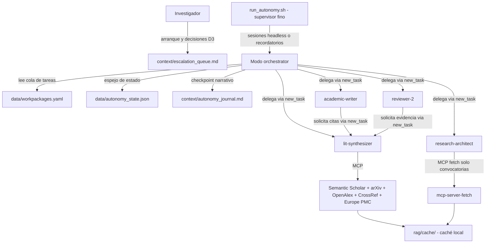
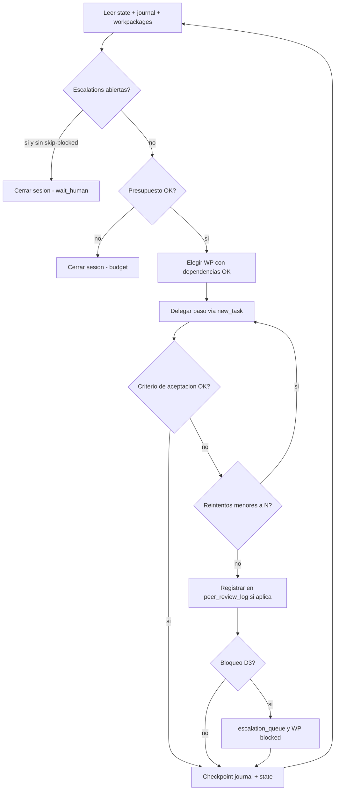
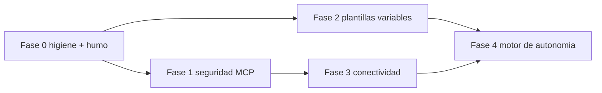

# Diseño de evolución de BecarioGPT: autonomía prolongada, estructura variable y conectividad ampliada

> Documento de diseño (solo diseño, sin implementación). Elaborado sobre la línea base auditada: [`init_paper.sh`](../init_paper.sh) de 555 líneas, [`.roomodes`](../.roomodes), 8 skills en [`.roo/skills/`](../.roo/skills) y [`.roo/mcp.json`](../.roo/mcp.json).

---

## 1. Arquitectura objetivo

### 1.1 Principios conservados

1. **SSOT por fichero**: `workpackages.yaml` sigue siendo el plan (SSOT del *qué*), `hypothesis_matrix.md` la verdad de objetivos/hipótesis, `stats_summary.json` la de datos, `references.bib` la bibliográfica. La autonomía añade **estado de ejecución** (`data/autonomy_state.json`) y **narrativa de ejecución** (`context/autonomy_journal.md`) como ficheros nuevos separados del plan: el orquestador nunca reescribe el plan, solo marca avance en su espejo.
2. **Tolerancia cero a alucinación**: los marcadores `\todo{CITA REQUERIDA}` / `\todo{DATO PENDIENTE}` y el ciclo de cierre de [`rules.md`](../.roo/rules/rules.md) §5 permanecen intactos; el motor de autonomía solo acelera su cierre, no lo salta.
3. **Restricción de scaffold**: [`init_paper.sh`](../init_paper.sh) sigue siendo un bash único sin dependencias más allá de `mkdir`, `cp`, `cat`, `find`, `ls`, `printf`, `echo`, `test` (redirecciones `<` incluidas: son shell puro). El runner de autonomía y los tests son piezas **añadidas** al repo, no dependencias nuevas del script.

### 1.2 Vista de la arquitectura destino



Piezas nuevas respecto al estado actual:

| Pieza | Ubicación | Responsable de crearla |
|---|---|---|
| Modo `orchestrator` | [`.roomodes`](../.roomodes) | scaffold [6.1] L170-179 |
| Skill `autonomy-loop` | `.roo/skills/autonomy-loop/SKILL.md` | scaffold [6.2] L182-191 |
| Runner `run_autonomy.sh` + `run_autonomy.ps1` | raíz del repo y copiado al proyecto | scaffold (nuevo bloque [6.5]) |
| Estado, journal, escalado, telemetría | `data/autonomy_state.json`, `context/autonomy_journal.md`, `context/escalation_queue.md`, `data/telemetry/` | scaffold [7] y [8] |
| Catálogo de plantillas | `templates/common/` + `templates/<tipo>/` | scaffold [7] refactorizado |
| Servidores MCP adicionales | [`.roo/mcp.json`](../.roo/mcp.json) | fase 3 del roadmap |
| Suite de humo | `tests/scaffold_smoke.sh` | fase 0 del roadmap |

---

## 2. Motor de autonomía (prioridad 1)

### 2.1 Alternativas evaluadas

| Criterio | (a) Solo modo orquestador con `new_task` | (b) Solo runner externo headless | (c) Híbrido: runner fino + modo orquestador |
|---|---|---|---|
| Autonomía de horas | Limitada: una sesión LLM se agota por contexto y deriva | Sí, con relanzamientos | Sí: sesiones cortas + relanzamiento |
| Cumple sin daemon obligatorio | Sí | No (exige CLI headless) | Sí: degrada a (a) si no hay CLI |
| Aplicación dura de presupuesto | No (depende del LLM contar bien) | Sí (timeout/ciclos en bash) | Sí (dura el runner, blanda el modo) |
| Reanudación fiable | Media (el LLM debe releer todo) | Alta (estado en ficheros) | Alta (estado en ficheros) |
| Complejidad nueva | 1 modo + 1 skill | 1 script + prompts | 1 modo + 1 skill + 1 script delgado |
| Riesgo de deriva científica | Alto en sesiones largas | Medio (sesiones frescas) | Bajo-medio (checkpoint por iteración) |

**Recomendación: (c) híbrido**, con dos propiedades clave:

- **El plan vive en ficheros, no en el contexto del LLM.** Toda iteración empieza y termina leyendo/escribiendo `data/autonomy_state.json` y `context/autonomy_journal.md`; el contexto de la sesión es desechable.
- **Degradación elegante**: si no existe CLI headless o el usuario no quiere usarla, el modo `orchestrator` funciona solo en la UI interactiva con el mismo protocolo (mismas skills, mismo journal); el runner pasa a ser un *recordatorio* opcional, no un requisito. Esto respeta la restricción «sin daemon externo obligatorio».

Justificación frente a (a): una sesión LLM no puede garantizar «horas» sin intervención (contexto, desconexiones, coste imprevisible) y el freno L59 de research-architect no es aplicable a un bucle sin humano si no se redefinen las clases de decisión (§2.6). Justificación frente a (b): un runner sin modo orquestador obliga a reconstruir la coordinación por `new_task` en prompts de una sola sesión, perdiendo la validación cruzada writer→reviewer que ya existe en los modos.

### 2.2 Cola de tareas: `workpackages.yaml` como plan

`workpackages.yaml` (nace en [7.5], L375-391; contrato en [`grant-workpackages`](../.roo/skills/grant-workpackages/SKILL.md) reglas 1-7) se extiende **de forma retrocompatible** con campos opcionales:

```yaml
workpackages:
  - id: WP1
    title: ...
    objectives: ["O1"]
    deliverables:
      - "D1.1: <entregable> (criterio: <verificacion medible>)"
    milestones: [...]
    effort_pm: 0.0
    risks: [...]
    # ---- extension autonomia (opcional, no rompe el contrato actual) ----
    depends_on: []          # IDs de WP previos
    acceptance:             # verificaciones ejecutables por el orquestador
      - "grep -n H1 src/03_results.tex"
      - "test -s data/stats_summary.json"
```

Regla de propiedad: **el plan lo sigue editando solo research-architect** (via grant-workpackages). El orquestador **no toca** `workpackages.yaml`: mantiene el estado de ejecución en su espejo (§2.4). Si el avance exige cambiar el plan (nuevo WP, reordenar), el orquestador lo escala (D3) o delega a research-architect con una solicitud motivada.

### 2.3 Modo `orchestrator` (nuevo)

Alta en [`.roomodes`](../.roomodes) siguiendo el patrón existente:

- `slug: orchestrator`, `name: 🧭 Orquestador de Autonomía`.
- `groups`: `read` + `edit` con `fileRegex: ^(context/autonomy_journal\.md|context/escalation_queue\.md|data/autonomy_state\.json)$`. **Sin grupo mcp**: toda búsqueda sigue delegándose en lit-synthesizer (monopolio §6 intacto).
- `customInstructions` (esbozo del contrato):
  1. Cada iteración: leer `data/autonomy_state.json`, `context/autonomy_journal.md` (cola), `data/workpackages.yaml` y `context/hypothesis_matrix.md`.
  2. Elegir el siguiente WP con `depends_on` satisfecho según el espejo; descomponerlo en pasos delegables.
  3. Delegar cada paso por `new_task` al modo responsable con criterio de aceptación explícito; verificar el criterio con comandos (`grep`, `test -s`, `latexmk`).
  4. Checkpoint obligatorio al cierre de cada paso: append al journal + escritura del estado.
  5. Presupuesto blando: si `iterations_used >= max_iterations` o `deadline` excedido, cerrar limpio y registrar `status: budget_exhausted`.
  6. Bloqueos: clasificar D1/D2/D3 (§2.6); D3 → registrar en `context/escalation_queue.md` y marcar el WP como `blocked` en el espejo; continuar con otro WP independiente si existe; si no, terminar la sesión.
  7. Prohibido: editar `src/`, `data/workpackages.yaml`, `data/stats_summary.json`, `src/references.bib`, `reviews/`; buscar literatura directamente; inventar datos o citas.

Skill asociada `.roo/skills/autonomy-loop/SKILL.md` con: protocolo de iteración, plantilla de entrada de journal, formato de checkpoint, tablas de backoff por fuente (§4.4), protocolo de verificación de `acceptance` y norma de cierre de sesión.

### 2.4 Checkpoints reanudables

**Decisión de ubicación**: narrativa en `context/` (la leen todos los modos y es texto) y estado máquina en `data/` (estructurado, lo parsea el runner). Ambos nacen en el scaffold (bloque [7.11] nuevo) para que `orchestrator` y el runner los encuentren siempre.

- `context/autonomy_journal.md` — **append-only**. Entrada tipo:

  ```
  | AAAA-MM-DD HH:MM | WP1 | DELEGADO academic-writer D2.3 | 03_results con H1 citado | OK |
  ```

  Columnas: fecha-hora ISO, WP, evento (DELEGADO | VERIFICADO | FALLO | ESCALADO | CHECKPOINT | SESION_FIN), detalle, resultado. Prohibido borrar entradas (patrón de `peer_review_log.md`).
- `data/autonomy_state.json` — **nace parseable** (mismo criterio que `stats_summary.json` en [7.4], L362-372):

  ```json
  {
    "project_type": "imrad",
    "session": {"n": 0, "started_utc": null, "ended_utc": null, "end_reason": null},
    "wp_status": {},
    "open_todos": {"cita_requerida": 0, "dato_pendiente": 0},
    "budget": {"max_iterations": 40, "iterations_used": 0,
               "max_wallclock_min": 240, "deadline_utc": null},
    "escalations_open": 0,
    "next_action": "read_workpackages"
  }
  ```

  `wp_status` mapea `WP1: pending|in_progress|blocked|done`. El conteo `open_todos` se recalcula con `grep -c '\\todo'` al inicio y fin de sesión (mismos greps de [peer-audit](../.roo/skills/peer-audit/SKILL.md) A2).

**Reanudación**: al arrancar (runner o humano), el orquestador valida: (1) JSON/YAML parseables, (2) coherencia `wp_status` vs journal, (3) que `references.bib` y `evidence_notes.md` siguen consistentes (A3 abreviado). Si algo está roto, escala antes de continuar. Opcional (decisión de usuario): si el proyecto está bajo git, el runner hace `git add -A && git commit` como checkpoint binario tras cada sesión; **sin git, el par journal+state es suficiente**.

### 2.5 Presupuesto, límites y telemetría

- **Límites duros (runner)**: `--max-sessions N`, `--max-session-min M`, `--deadline HH:MM`, detección de `escalations_open > 0` o `next_action: wait_human` para no relanzar. El runner es el único que puede *matar* sesiones; nunca lo hace en mitad de una escritura de fichero SSOT (espera el checkpoint; por eso el checkpoint es por paso, no por sesión).
- **Límites blandos (orquestador)**: contador `iterations_used` en el estado; cada delegación `new_task` suma 1 iteración; al llegar al máximo, cierre limpio con `end_reason: budget`.
- **Coste/tokens**: el stack Roo/Zoo no expone un contador fiable de tokens desde bash; el diseño lo trata como métrica opcional: si el backend headless la expone, el runner la añade a telemetría; si no, el presupuesto se expresa en iteraciones + tiempo + nº de llamadas MCP (el journal registra cada búsqueda). No se promete precisión en USD; se promete acotación operativa.
- **Telemetría**: `data/telemetry/run_*.jsonl` escrito por el runner (una línea por evento: sesión iniciada/terminada, código de salida, motivo). El journal cubre el nivel semántico; telemetría cubre el nivel operativo. `data/telemetry/` entra en `.gitignore` del proyecto (bloque [7.10]).

### 2.6 Backoff real y escalado a humano

**Backoff (sustituye al «esperar 15-20 s» puntual de s2-search L51)**:

| Fuente | Cortesía previa | Ante 429/error | Máx. intentos | Al agotar |
|---|---|---|---|---|
| Semantic Scholar | 1.1 s entre llamadas | +20 s, +40 s, +80 s, +160 s | 4 | ESCALADO (D1) y marcador abierto |
| arXiv | 3 s entre llamadas | +10 s, +30 s, +90 s | 3 | ESCALADO y marcador abierto |
| OpenAlex | `mailto=` en cada llamada | +5 s, +15 s, +45 s | 3 | ESCALADO y marcador abierto |
| CrossRef (DOI) | `mailto=` en cada llamada | +5 s, +15 s, +45 s | 3 | el marcador permanece abierto (regla s2-search L53: nunca cerrar aproximando) |
| Europe PMC | 1 s entre llamadas | +10 s, +30 s | 3 | ESCALADO y marcador abierto |

Regla transversal: tras agotar reintentos, el orquestador registra el bloqueo, **deja el `\todo{}` abierto** (regla §5 de rules.md) y sigue con otra tarea; no reintentar más en la misma sesión (evita quemar presupuesto en una fuente caída).

**Clasificación de decisiones (redefinición del freno de research-architect L59)**:

| Clase | Definición | Ejemplos | ¿Quién decide en modo autónomo? |
|---|---|---|---|
| **D1 Operativa** | Reversible, sin impacto científico | reintentos, orden interno de pasos, reformular consulta de búsqueda | El modo delegado, solo (ya lo hace hoy) |
| **D2 Metodológica reversible** | Afecta a estructura/redacción pero es revertible y trazable | qué checklist EQUATOR aplica, cómo partir una sección, qué WP ejecutar primero entre independientes | El orquestador, **documentando justificación en el journal** |
| **D3 De fondo** | Hipótesis nuevas, cambio de alcance/diseño, presupuesto, autoría, envío | añadir H3, cambiar diseño de estudio, decidir enviar a revista B | **Solo el investigador** vía `context/escalation_queue.md` |

Cambio en [`.roomodes`](../.roomodes) L59: la instrucción 1 de research-architect pasa de «NUNCA tomes decisiones científicas de fondo por tu cuenta» a la versión clasificada: «En modo autónomo puedes decidir D1 y D2 si lo documentas en `context/autonomy_journal.md`; toda decisión D3 debe registrarse en `context/escalation_queue.md` y esperar al investigador». En modo interactivo el comportamiento actual se mantiene.

`context/escalation_queue.md` (nace en el scaffold) — tabla: `ID | WP | Clase D3 | Decisión requerida | Opciones | Respuesta | Fecha | Estado`. El orquestador solo escribe filas ABIERTAS; solo el investigador las cierra. El runner **no relanza** mientras haya escalations abiertas no respondidas (o lo hace en modo «solo tareas no bloqueadas», configurable con `--skip-blocked`).

### 2.7 Ciclo de una iteración



El criterio de aceptación de cada delegación proviene de los campos `acceptance` del WP (§2.2) o, si no existen, del contrato del modo delegado (p. ej. visto bueno de [peer-audit](../.roo/skills/peer-audit/SKILL.md) con 0 CRÍTICOS ABIERTOS antes de dar un WP de redacción por terminado).

---

## 3. Sistema de plantillas variables (prioridad 2)

### 3.1 Catálogo de tipos

| `--type` | Nombre | Clase LaTeX | Secciones/capítulos | Artefactos extra |
|---|---|---|---|---|
| `imrad` *(default)* | Artículo empírico IMRaD | `article` | 01_introduction → 04_discussion (como hoy) | ninguno adicional |
| `prisma` | Revisión sistemática PRISMA | `article` | 01_introduction, 02_methods (protocolo, búsqueda, screening, extracción, sesgo), 03_results (síntesis), 04_discussion | `data/extraction_sheet.csv`, `src/figures/prisma_flow.tex` (tabla LaTeX, per prisma-synthesis F2 L37), `context/prisma_checklist.md` (27 ítems), protocolo en `rag/calls/protocol.md` |
| `thesis` | Tesis/TFG/TFM por capítulos | `report` | `src/chapters/00_front.tex`, `01_introduction.tex` … `N_conclusions.tex`, apéndices `src/appendices/` | `context/thesis_outline.md` (capitulación SSOT), glosario de acrónimos |
| `engineering` | Paper de ingeniería / technical report | `article` | 01_introduction, 02_related_work, 03_architecture, 04_implementation, 05_evaluation, 06_conclusion, `src/appendices/` | plantilla de tabla de experimentos (latex-tables) |
| `grant` *(opcional)* | Propuesta competitiva / memoria | `article` (o plantilla institucional) | 01_excellence, 02_impact, 03_implementation (WPs, Gantt, presupuesto) | Gantt como tabla LaTeX derivada de `workpackages.yaml`, tablas de entregables/riesgos; cifras de presupuesto siempre `\todo{DATO PENDIENTE}` (grant-workpackages regla 7) |

Todos los tipos conservan el núcleo común: `context/` (call_guidelines, hypothesis_matrix, evidence_notes, autonomy_journal, escalation_queue), `data/` (stats_summary, workpackages, autonomy_state), `src/references.bib`, `reviews/peer_review_log.md`, `rag/`, `.gitignore`, `.roomodes`, `.roo/`.

### 3.2 Estructura del repo

```text
templates/
├── common/                  # núcleo común a todos los tipos
│   ├── context/call_guidelines.md
│   ├── context/hypothesis_matrix.md
│   ├── context/evidence_notes.md
│   ├── context/autonomy_journal.md
│   ├── context/escalation_queue.md
│   ├── data/stats_summary.json
│   ├── data/workpackages.yaml
│   ├── data/autonomy_state.json
│   ├── src/references.bib
│   ├── reviews/peer_review_log.md
│   ├── .gitignore
│   └── postcheck.list       # post-condición común
├── imrad/
│   ├── src/main.tex
│   ├── src/01_introduction.tex ... src/04_discussion.tex
│   └── postcheck.list       # p.ej. src/main.tex + src/03_results.tex
├── prisma/
│   ├── src/main.tex
│   ├── src/01_introduction.tex ... src/04_discussion.tex
│   ├── data/extraction_sheet.csv
│   ├── src/figures/prisma_flow.tex
│   └── postcheck.list
├── thesis/ ...  engineering/ ...  grant/
```

Los ficheros `.gitkeep` de `src/figures/` y `rag/{calls,past_projects,templates}` siguen creándose con `mkdir -p` (L153-162, contrato innegociable).

### 3.3 Mecanismo de generación (refactor de [7])

Sustituye los heredocs de [7.1]-[7.10] (L273-526) por copia parametrizada; `write_template` (L70-78) se mantiene intacta y cambia solo la forma de alimentar su stdin:

```bash
TYPE="${TYPE:-imrad}"
# 1) núcleo común
find "$SCRIPT_DIR/templates/common" -type f | while IFS= read -r _src; do
    _rel=${_src#"$SCRIPT_DIR/templates/common/"}
    [ "$_rel" = "postcheck.list" ] && continue
    write_template "$PROJECT_DIR/$_rel" < "$_src"
done
# 2) overlay del tipo (mismo patrón con templates/$TYPE)
# 3) post-condición parametrizada:
cat "$SCRIPT_DIR/templates/common/postcheck.list" \
    "$SCRIPT_DIR/templates/$TYPE/postcheck.list" | sort -u | \
    while IFS= read -r _key; do ... test -f "$PROJECT_DIR/$_key" ...; done
```

Notas de diseño:

- **`--type` es opcional con default `imrad`** (recomendación): preserva el uso actual `bash init_paper.sh mi-paper` documentado en README L116-125 y AGENTS.md; un valor fuera del catálogo produce `msg_err` con la lista válida y `exit 1` (mismo estilo que el rechazo de rutas L96-105). `project-init` (Paso 1) pasa a verificar la post-condición **del tipo** leyendo `postcheck.list` en vez de la lista fija.
- `postcheck.list` reemplaza la lista fija de [8] (L532-537) y **añade** `.roo/mcp.json` (ver §5.4) y los ficheros de autonomía (journal, state, escalation_queue).
- `stats_summary.json` nace con `"project_type": "<tipo>"` junto a `study_metadata.design` (trazabilidad para methods-reporting/peer-audit A6) y `autonomy_state.json` nace con `"project_type"` espejado.
- Las plantillas siguen siendo texto plano: sin sustitución de variables compleja; los únicos valores interpolables son el tipo (ya fijado por el fichero) y el año (`$(date +%Y)` evitado a propósito: texto estático con `AAAA-MM-DD` como hoy, para mantener idempotencia y diffs limpios).

### 3.4 Compatibilidad con modos y skills (verificado contra los fileRegex)

| Contrato | Estado frente a plantillas variables | Acción requerida |
|---|---|---|
| academic-writer `^(src/.*\.(tex|md)\|src/figures/.*)$` (L34) | `src/chapters/*.tex`, `src/appendices/*`, `src/figures/*` ya cubiertos por `src/.*` | ninguna |
| reviewer-2 `^reviews/.*\.md$` (L51) | cubre logs por tipo | ninguna |
| lit-synthesizer `^(context/evidence_notes\.md\|src/references\.bib)$` (L16) | igual en todos los tipos | añadir `rag/cache/.*` solo si se adopta la caché (§4.3) |
| research-architect `^(context/.*\|data/.*\|rag/calls/.*)$` (L69) | cubre extraction_sheet, prisma_checklist, thesis_outline | ninguna |
| [peer-audit](../.roo/skills/peer-audit/SKILL.md) A1 (L16): `grep -nE "O[0-9]" src/*.tex` | **rompe con subdirectorios** (`src/chapters/`): el glob `src/*.tex` no es recursivo | cambiar A1/A2/A3/A5 a `grep -rnE ... src --include=*.tex` |
| [methods-reporting](../.roo/skills/methods-reporting/SKILL.md) A6 → `study_metadata.design` | sin cambio de contrato | ampliar el mapeo con `systematic_review → PRISMA 2020` y documentar valores válidos por tipo |
| [grant-workpackages](../.roo/skills/grant-workpackages/SKILL.md) | contrato retrocompatible con los campos `depends_on`/`acceptance` | documentar los campos opcionales en la regla del contrato |
| [project-init](../.roo/skills/project-init/SKILL.md) | post-condición fija de 5 ficheros (Paso 1) | verificar según `postcheck.list` del tipo detectado en `stats_summary.json` (`project_type`) |

---

## 4. Conectividad ampliada (prioridad 3)

### 4.1 Servidores MCP propuestos

| Servidor | Herramienta sugerida | Uso | Rate limit de referencia |
|---|---|---|---|
| `semantic-scholar-mcp` (existente) | actual | búsqueda y verificación S2 | ~1 req/s (429→15-20 s) |
| `arxiv-mcp` | servidor MCP arXiv (pip/uvx) | preprints CS/física; complementa S2 cuando el paper no está indexado | cortesía 1 req/3 s |
| `openalex-mcp` | OpenAlex API (mailto polite pool) | metadatos, autores, instituciones, citas; sin clave (gratuito) | ~10 req/s con mailto |
| `crossref-mcp` | CrossRef REST (mailto) | **verificación DOI independiente** (cierre S3 de s2-search con segunda fuente) | 50 req/s con mailto |
| `europepmc-mcp` / PubMed | Europe PMC REST | biomedicina; cubre la base PubMed exigida por prisma-synthesis F1 (L29) que hoy es solo manual | ~1-2 req/s |
| `fetch` | `mcp-server-fetch` (oficial, `uvx mcp-server-fetch`) | convocatorias, guías EQUATOR/PRISMA, páginas de revistas — **no literatura** | según sitio; backoff genérico |

Prisma-synthesis F1 (L29-31) sigue exigiendo documentar la estrategia en `rag/calls/` **antes** de buscar; las nuevas fuentes solo sustituyen la ejecución manual de la búsqueda, no el protocolo.

### 4.2 Matriz de permisos MCP (resuelve la ambigüedad research-architect vs §6)

| Modo | Grupo mcp | Servidores | Justificación |
|---|---|---|---|
| `lit-synthesizer` | sí | semantic-scholar, arxiv, openalex, crossref, europepmc | **monopolio de búsqueda de literatura** (§6 se mantiene; se amplía el catálogo de fuentes) |
| `research-architect` | sí (restringido) | **solo `fetch`** | convocatorias y documentación no académica (call_guidelines). §6 v2 redacta: «la búsqueda de *artículos* es de lit-synthesizer; el *fetch de convocatorias/documentación* es de research-architect; la *verificación de DOI de literatura* es de lit-synthesizer (CrossRef)». Se elimina el acceso de research-architect a buscadores académicos, coherente con L59 |
| `academic-writer` | no | — | delega (sin cambio) |
| `reviewer-2` | no | — | delega (sin cambio) |
| `orchestrator` | no | — | delega (nuevo modo, §2.3) |

### 4.3 Caché local en `rag/cache/`

- `rag/cache/<servidor>/<hash-de-consulta>.json` con: consulta, parámetros, respuesta, fecha-hora UTC, servidor.
- Regla en s2-search (nueva fase S1.0): *antes* de llamar al API, comprobar caché; *después* de una respuesta exitosa, escribirla. TTL de 30 días para metadatos (revalidar) e indefinido para entradas BibTeX ya verificadas con DOI.
- Permisos: ampliar `fileRegex` de lit-synthesizer a `^(context/evidence_notes\.md|src/references\.bib|rag/cache/.*)$`. El scaffold crea `rag/cache/` por servidor con `mkdir -p` (L160-162 extendidas).
- Efecto: el rate limit deja de ser el cuello de botella en reejecuciones y la autonomía prolongada gasta menos presupuesto en búsquedas repetidas.

### 4.4 Seguridad de claves y arranque MCP

Cambios sobre [`.roo/mcp.json`](../.roo/mcp.json):

1. **Clave fuera del fichero** (hoy L18 en claro): `"SEMANTIC_SCHOLAR_API_KEY": "${SEMANTIC_SCHOLAR_API_KEY}"`. Roo Code expande variables de entorno en `env`; el scaffold comprueba al generar que la variable existe y emite `[WARN]` con las instrucciones si no (`set +u` local para no abortar). La clave actual se revoca y se reemplaza por una nueva **solo en el entorno del usuario**, nunca en el repo.
2. **Sin ruta absoluta de Python** (hoy L4 `C:\Python315\python.exe`): arranque directo con `uvx`:
   ```json
   "command": "uvx",
   "args": ["--from", "git+https://github.com/adborgon/semantic-scholar-mcp.git", "semantic-scholar-mcp", "serve"]
   ```
   Alternativa reproducible sin red en cada arranque: `uv tool install` una vez + `"command": "semantic-scholar-mcp"` (decisión de usuario: frescura vs determinismo).
3. **Eliminar `--refresh-package`** (hoy L10): reinstala desde git en cada arranque; es la causa de lentitud y fragilidad offline. Con `uvx` el cacheo es automático; con `uv tool install` es explícito.
4. `PYTHONIOENCODING`/`PYTHONUTF8` (L19-20) se conservan; `autoApprove`/`alwaysAllow` se replican para los nuevos servidores.
5. [`init_paper.sh`](../init_paper.sh) bloque [6.4] (L254-266) mantiene la copia noclobber y el `[WARN]` actual (L262), reforzado con la comprobación de env vars.

---

## 5. Extras de calidad (prioridad 4)

1. **Suite de humo `tests/scaffold_smoke.sh`** (bash puro, mismo estilo que el scaffold): para cada tipo del catálogo — genera en `mktemp -d`, verifica la post-condición del `postcheck.list` correspondiente, valida parseabilidad (`python -c "import json;json.load(...)"` y `yaml.safe_load`; python ya es dependencia de facto vía mcp.json), verifica `-h` (exit 0 tras corrección), rechazo de rutas con `-`/`..`, y modo `--force` noclobber (crear, tocar un fichero SSOT, re-ejecutar, comprobar que no se sobrescribe). Salida ASCII con `[OK]/[ERROR]`.
2. **Validación de compilación LaTeX en el ciclo writer→reviewer**: nueva sección en `autonomy-loop` y nota en academic-writer: tras cada lote de redacción, `latexmk -pdf -interaction=nonstopmode -halt-on-error -output-directory=build src/main.tex`; el orquestador registra `OK/ERRORES + líneas` en el journal; reviewer-2 verifica el último resultado de compilación antes del visto bueno (checklist A7 nueva en peer-audit: «manuscrito compila sin errores» como requisito [MAYOR]). Si latexmk no está instalado, el paso se registra como `SKIPPED (latexmk ausente)` y no bloquea.
3. **Deduplicación del heredoc de respaldo**: mover `ACADEMIC_CORE_EOF` (L209-248) a un fichero plano `templates/common/.roo_rules_fallback.md`; el bloque [6.3] (L204-251) copia ese fichero con `cp` en vez de mantener 40 líneas duplicadas que ya han divergido del formato real de rules.md.
4. **`mcp.json` en la post-condición**: añadirlo a la lista `test -f` de [8] (L532-543) junto a `context/autonomy_journal.md`, `data/autonomy_state.json` y `context/escalation_queue.md` — el proyecto sin MCP es funcionalmente cojo y debe fallar ruidosamente.
5. **`-h/--help` con exit 0** (hoy L92-95 sale 1): convención estándar; la suite de humo lo verifica.
6. **Discrepancias doc-código** (auditoría G4): README L22-26 lista `rules-code/debug/ask/architect/research-architect` que el script no copia — documentar que solo `rules.md` se replica como `00_academic_core.md`; [`.roomodes`](../.roomodes) L7 menciona «Zotero, Qdrant» inexistentes — reescribir la instrucción 1 de lit-synthesizer al catálogo real de servidores; [project-init](../.roo/skills/project-init/SKILL.md) L3 menciona `/init_project` / `/init_article` — sustituir por `bash init_paper.sh <proyecto>`.

---

## 6. Roadmap de implementación

Orden pensado para que cada fase sea independiente, verificable con la suite de humo y deje el sistema **siempre funcional**. Antes de la fase 0: test manual del script actual en directorio temporal (AGENTS.md lo recomienda).

### Fase 0 — Higiene y red de seguridad *(riesgo: bajo)*

| Cambio | Ficheros | Verificación |
|---|---|---|
| `-h` exit 0 | [`init_paper.sh`](../init_paper.sh) L92-95 | suite de humo |
| Heredoc de respaldo → fichero plano | [7] L209-248, nuevo `templates/common/.roo_rules_fallback.md` | humo: 00_academic_core.md integro |
| `mcp.json` + ficheros autonomía en post-condición | [8] L532-543 | humo |
| Suite `tests/scaffold_smoke.sh` | nuevo | `bash tests/scaffold_smoke.sh` verde |
| README/.roomodes/project-init: sincronizar docs | README L22-26, L27 (rules-code...), `.roomodes` L7, project-init L3 | revisión manual |

**Decisión de usuario**: ninguna bloqueante.

### Fase 1 — Seguridad MCP *(riesgo: medio; puede romper el arranque del servidor)*

| Cambio | Ficheros | Riesgo y mitigación |
|---|---|---|
| Clave → `${SEMANTIC_SCHOLAR_API_KEY}` + revocación de la actual | `.roo/mcp.json` L18 | si la var no está exportada el servidor no arranca: el scaffold avisa y la docs indican cómo exportarla (Git Bash: `~/.bashrc`; PowerShell: `$PROFILE`) |
| `uvx` directo, sin ruta absoluta ni `--refresh-package` | `.roo/mcp.json` L4-15 | requiere `uv` en PATH; verificar con `uvx --version` antes de migrar; fallback documentado con `uv tool install` |

**Decisión de usuario**: modo de instalación (`uvx` cacheado vs `uv tool install` fijo); dónde se define la clave (env de usuario).

### Fase 2 — Plantillas variables *(riesgo: medio-alto; toca el contrato del scaffold)*

| Cambio | Ficheros | Riesgo y mitigación |
|---|---|---|
| `--type` opcional (default `imrad`) + validación de catálogo | [2] parseo L83-122, [5] mkdir extensible | regresión: la suite de humo cubre los 5 tipos + default |
| Refactor [7] a `templates/common` + overlay por tipo | [7] L268-526 entero | mayor cambio del script: hacerlo en dos commits (extraer common; añadir tipos) con humo entre ambos |
| Post-condición parametrizada por `postcheck.list` | [8] L528-547 | humo por tipo |
| peer-audit greps recursivos (`src --include=*.tex`) | peer-audit A1-A5 | auditar un proyecto thesis de prueba |
| `project_type` en stats_summary/autonomy_state | plantillas JSON | humo de parseabilidad |
| project-init: post-condición por tipo | project-init Paso 1 | revisión |

**Decisiones de usuario**: ¿qué tipos entran en la primera hornada (mínimo: imrad, prisma, thesis, engineering)? ¿`grant` ahora o pospuesto? ¿`--type` default `imrad` u obligatorio? (recomendado: opcional).

### Fase 3 — Conectividad ampliada *(riesgo: medio; dependencias externas)*

| Cambio | Ficheros | Riesgo y mitigación |
|---|---|---|
| Añadir servidores (arXiv, OpenAlex, CrossRef, Europe PMC, fetch) + `autoApprove` | `.roo/mcp.json` | cada servidor se activa uno a uno; probar cada uno con una consulta real antes de usarlo en proyectos |
| §6 v2 (monopolio de literatura vs fetch de convocatorias) | `rules.md` (y su fallback), `.roomodes` L59 y grupos de research-architect | coherencia: cambiar rules.md y .roomodes en el mismo commit |
| Caché `rag/cache/` + fase S1.0 en s2-search + fileRegex | s2-search, `.roomodes` L16, mkdir L160-162 | humo: directorios nacen; TTL documentado |
| Tablas de backoff por fuente en s2-search y autonomy-loop | skills | revisión |

**Decisiones de usuario**: qué fuentes activar de verdad (cada una es una dependencia); ¿research-architect conserva `fetch` o pierde todo mcp (más estricto)?; mailto polaca para OpenAlex/CrossRef (correo del usuario).

### Fase 4 — Motor de autonomía *(riesgo: alto; mayor valor)*

| Cambio | Ficheros | Riesgo y mitigación |
|---|---|---|
| Modo `orchestrator` + skill `autonomy-loop` | `.roomodes`, `.roo/skills/autonomy-loop/` | deriva científica: presupuestos duros + escalado D3 + journal obligatorio; probar primero en un proyecto de juguete con `--max-sessions 1` |
| `run_autonomy.sh` (+ variante PowerShell si se pide) | nuevo en repo y copiado al proyecto | dependencia de CLI headless: si no existe, el modo funciona igualmente en UI (degradación §2.1) |
| Ficheros de estado/journal/escalado nacen en scaffold | plantillas common | ya cubierto por humo de fase 0/2 |
| `depends_on`/`acceptance` en workpackages + grant-workpackages | plantilla YAML, skill | retrocompatible: campos opcionales |

**Puntos de decisión del usuario (bloqueantes para esta fase)**:
1. ¿Existe CLI de Zoo/Roo headless en su instalación y cuál es el binario/flags? (define el adaptador del runner).
2. Presupuesto operativo: nº de iteraciones/sesión, tiempo máximo, si aplica límite de gasto del proveedor.
3. ¿Checkpoints con git commits automáticos o solo ficheros de estado?
4. ¿El runner relanza saltando WPs bloqueados (`--skip-blocked`) o espera siempre al humano?

### Mapa de dependencias entre fases



Fases 1 y 2 son paralelizables; 3 depende de 1 (arranque seguro de servidores) y 4 depende de 2 (post-condición parametrizada) y 3 (backoff y caché reales).

---

## 7. Resumen de decisiones abiertas para el investigador

| # | Decisión | Recomendación del diseño |
|---|---|---|
| D-1 | `--type` opcional vs obligatorio | Opcional con default `imrad` |
| D-2 | Tipos del catálogo inicial | imrad, prisma, thesis, engineering; `grant` pospuesto salvo necesidad |
| D-3 | Instalación MCP | `uvx` cacheado; clave en env var de usuario; revocar la clave actual |
| D-4 | Fuentes MCP a activar | Semantic Scholar + CrossRef (verificación) + OpenAlex primero; arXiv y Europe PMC según dominio; `fetch` para convocatorias |
| D-5 | research-architect y mcp | Mantiene grupo mcp con **solo** `fetch` (convocatorias); literatura sigue monopolizada por lit-synthesizer |
| D-6 | Motor de autonomía | Híbrido (c): modo `orchestrator` + `run_autonomy.sh` fino, con degradación a modo puro si no hay CLI |
| D-7 | Checkpoints | Ficheros de estado siempre; git commits opcionales si el proyecto está versionado |
| D-8 | Presupuesto inicial | 40 iteraciones, 240 min por sesión, sin límite USD (no medible con fiabilidad desde bash) — ajustable por flags |
